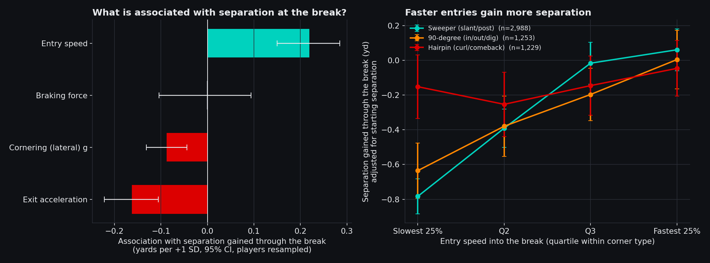
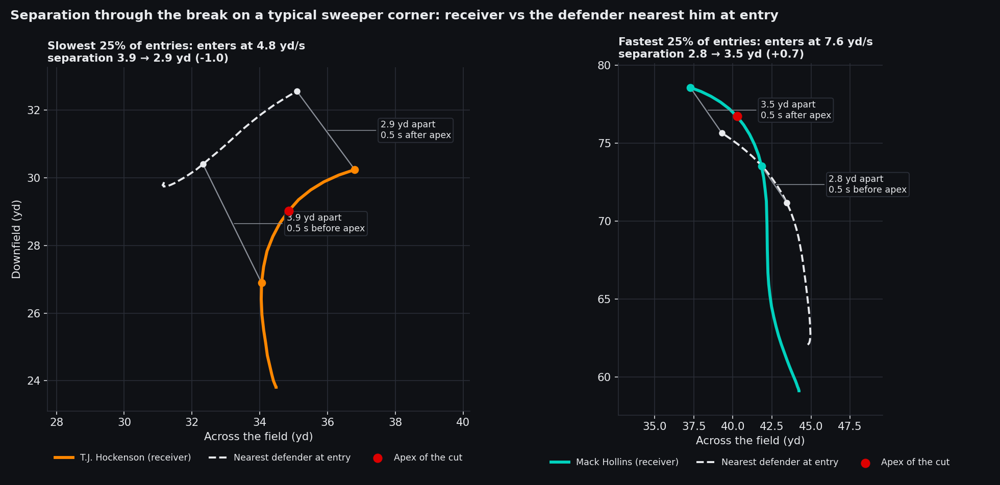
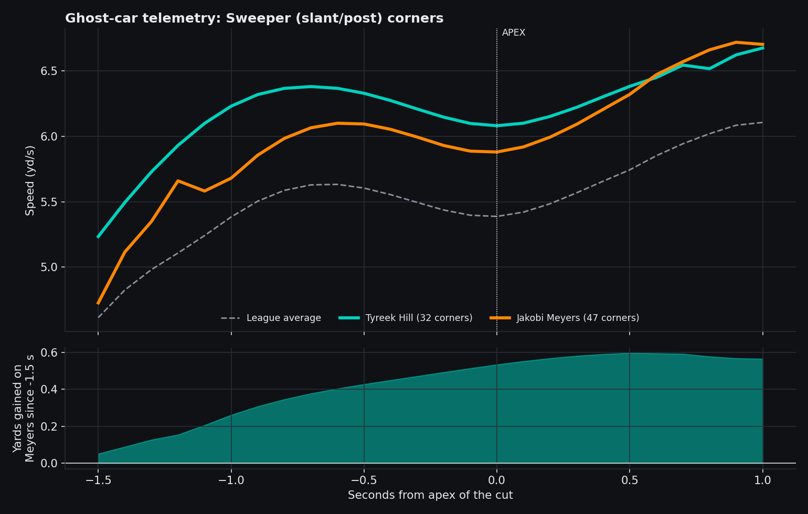
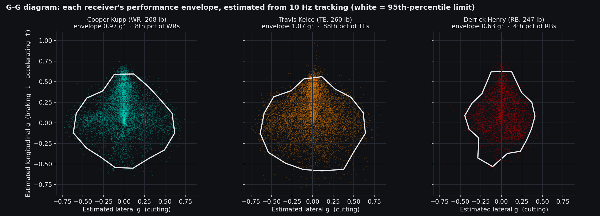
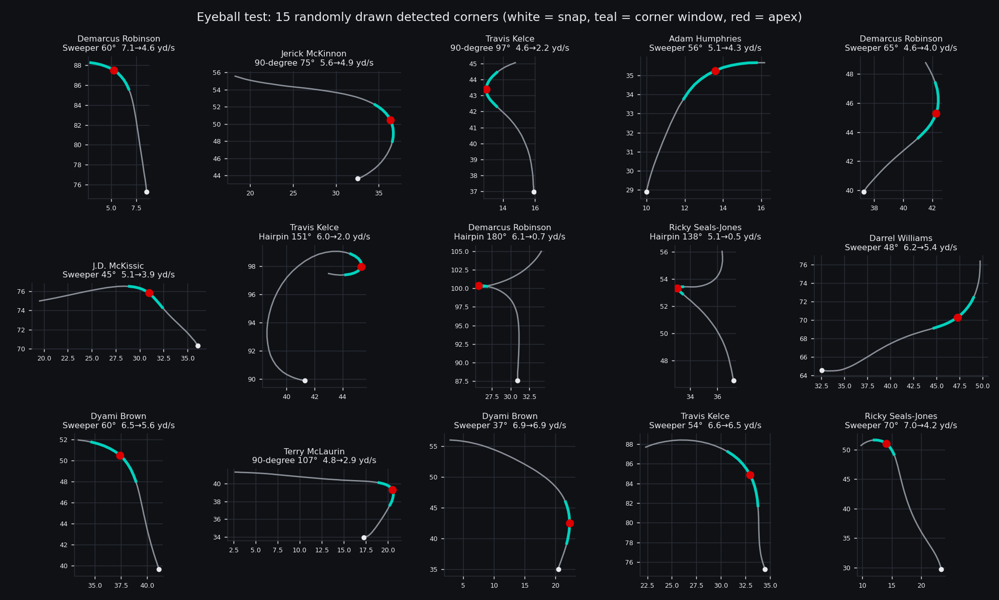

# Route Telemetry: F1-style corner analysis for NFL receivers

We analyzed 5,470 route breaks by NFL wide receivers, tight ends and running backs from 2021 Weeks 1-8, measuring each player's speed before the turn, braking, lowest speed during the turn, turning force and acceleration afterwards, and built an interactive tool to compare any two receivers. Speed going into a turn is linked to more space from the defender than speed kept through it: each step up in speed before the turn (+1 standard deviation, about 1 yd/s) is associated with 0.22 more yards of space through the turn (95% CI 0.15 to 0.28; 0.39 against one fixed defender), probably because the defender has to respect the chance he keeps running deep, while braking, turning force and acceleration after the turn show no positive association. Receiver coaches can use it to teach players to carry speed into their breaks, scouts to profile how players change direction, and broadcasters to compare any two receivers side by side. Turns are found from the change in a player's direction of travel in the tracking data, and the extra space is measured against the nearest coverage defender half a second before and after the slowest point of the turn, controlling for starting space, depth, turn angle and coverage type. Limits: tracking ends just after the throw so we measure space through the turn rather than at the catch, the result is observational, and eight weeks gives most players only 20-60 clean turns.

**Live tool:** https://jayantka.github.io/big-data-bowl-jk/ (or open [`docs/index.html`](docs/index.html) locally; no server needed)

## Details

### The finding



On sweeper corners, the slowest quarter of entries lose 0.78 yards of separation through the break while the fastest quarter gain 0.06. On 90-degree corners the gap is 0.63 yards. On hairpins, where every receiver brakes to a near stop, entry speed shows no clear relationship.

Corner types are geometry-based route families defined by turn angle, not charted route names. "Slant/post", "in/out/dig" and "curl/comeback" are shorthand for the routes each family typically contains.

**Is keeping speed through the cut linked to separation?** No. We expected it to be, but the share of entry speed a receiver keeps at the apex is slightly *negatively* related to separation gained (Spearman −0.13 on sweepers, −0.19 on 90-degree corners, 0.00 on hairpins). The stronger signal is how fast he arrives, which is consistent with the defender having to respect the vertical threat.

**Does it hold against one defender?** Yes, and more strongly. Locking onto the defender nearest the receiver at corner entry and following that same player through the cut, +1 SD of entry speed is associated with +0.39 yards (95% CI 0.29 to 0.48), and harder braking turns slightly negative (−0.16, CI −0.28 to −0.05).



The two plays above are the corners closest to the median of the slowest and fastest entry-speed quartiles, so they are typical examples rather than hand-picked ones.

### A second, cautionary finding

A receiver's G-G envelope is fairly stable between Weeks 1–4 and Weeks 5–8 (r = 0.80 across 125 players with enough frames in both halves), but among wide receivers it is not associated with getting open (Spearman −0.09 with separation at release, 0.05 with target rate). Cooper Kupp, the most-targeted player in the data, has one of the smallest envelopes of 103 WRs (tied 6th-smallest).

### The tool

Pick any two of 172 receivers and a corner type. It shows three things:

**Ghost-car overlay.** Average speed trace through the cut for both players and the league, plus the yards one gains on the other.



**G-G diagram.** Estimated braking and acceleration against estimated lateral g for every route frame, with the 95th-percentile envelope: the same plot race engineers use to see how much of the available grip a driver uses.



**Telemetry sheet.** Each player's numbers with percentiles at his position. The full table is in [`output/player_telemetry.csv`](output/player_telemetry.csv).

### Method

1. **Normalize** every play so the offense moves in the same direction.
2. **Find the corner.** For each player PFF tagged as running a route, take the frames from the snap onward and find the 1-second window with the largest change in direction of travel. A turn under 35° is a go route and has no corner. The apex is the slowest frame in that window.
3. **Measure it.** Entry speed (fastest point in the 1.5 s before the apex), apex speed, exit acceleration (0.5 s after), peak braking g, peak lateral g (speed × turn rate), and separation from the nearest coverage defender 0.5 s before and after the apex. Speed and heading are smoothed over 3 frames before differentiating.
4. **Classify by turn angle.** Sweepers (35–70°, typically slants and posts), 90-degree corners (70–115°, typically ins, outs and digs), hairpins (115°+, typically curls and comebacks).
5. **Keep clean corners only.** Entry at 4.5+ yd/s, apex at least 1 s after the snap, nearest defender 0.7–8 yards away at entry, man or zone coverage. This keeps 5,470 of 11,171 detected corners, from 38,927 routes.
6. **Model.** Linear regression of separation gained on the four standardized corner inputs, controlling for starting separation, turn angle, depth and man/zone. Confidence intervals resample players. The model is repeated with separation measured against one fixed defender as a robustness check.

Detection was checked by eye on randomly drawn corners:



### Assumptions and limitations

- **No catch-point data.** Tracking stops shortly after the pass is thrown, so separation is measured in a 1-second window around the break. Yards after catch are not observable.
- **Nearest defender, not assigned defender.** The data has no coverage assignments. The headline uses the closest coverage player at each moment; the robustness check follows whoever was closest at corner entry. In zone, neither is guaranteed to be the player responsible.
- **Observational.** Entry speed is associated with separation after controls, but route design, leverage and coverage calls are not fully captured, so this is not proof of cause.
- **Small player samples.** Player-level corner stats are only moderately stable between Weeks 1–4 and 5–8 (entry speed r = 0.59, braking 0.38, cornering 0.39, exit acceleration 0.17). The league-level finding rests on all 5,470 corners; individual rankings should be read with their corner counts.
- **Corner types come from geometry**, not from charted route names.
- **G values are estimates.** They come from differentiating 10 Hz tracking, so they are best used to compare players, not as precise force measurements.
- **Entry speed depends on depth.** Deeper breaks allow more build-up, so the model controls for depth and the tool also reports entry speed against expectation for the depth.

### Data

The dataset distributed for the event: 122 games from 2021 Weeks 1–8, with per-game tracking files plus `games.csv`, `plays.csv`, `players.csv` and `pffScoutingData.csv`. It is hosted publicly at [ThompsonJamesBliss/nfl-big-data-bowl-regional-event-data](https://github.com/ThompsonJamesBliss/nfl-big-data-bowl-regional-event-data) and is not committed to this repo.

### Run it

```bash
pip install -r requirements.txt
git clone https://github.com/ThompsonJamesBliss/nfl-big-data-bowl-regional-event-data dataset
python build.py dataset/data output      # about 1 minute: route-level telemetry for 122 games
python analyze.py dataset/data output    # findings, figures, dashboard data
```

| File | Purpose |
|---|---|
| `route_telemetry.py` | Corner detection and kinematics for a single play |
| `build.py` | Runs every game in parallel, finds targets, saves route-level data |
| `analyze.py` | Model, reliability checks, figures, dashboard data |
| `docs/` | Interactive tool (static page, no server needed) |
| `output/` | `player_telemetry.csv`, `findings.json` |
