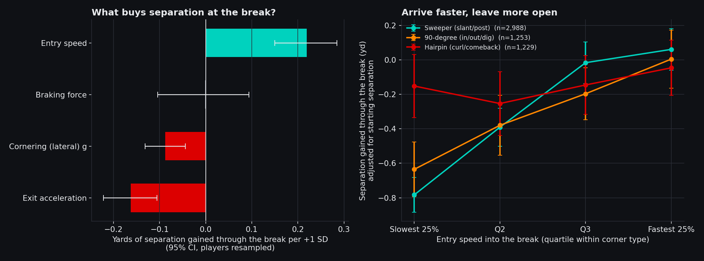

# Route Telemetry: F1-style corner analysis for NFL receivers

**What we built.** A Python pipeline and interactive comparison tool that treats every route break like a Formula 1 corner, measuring entry speed, braking force, apex speed, cornering g and exit acceleration for every WR, TE and RB route in the 2021 Weeks 1–8 tracking data (38,927 routes, 5,470 clean corners).
**What it reveals.** Separation is won on the straight, not in the corner: each +1 SD of entry speed into the break (about 1 yd/s) adds 0.22 yards of separation through the cut (95% CI 0.15 to 0.29; 0.39 when measured against the same defender throughout), while harder braking, higher cornering g and quicker exit acceleration add nothing or are slightly negative.
**A second, cautionary finding.** A receiver's G-G "performance envelope" is a highly repeatable athletic fingerprint (split-half r = 0.84), but among wide receivers it does not predict getting open (ρ = −0.09 with separation at release); Cooper Kupp, the most-targeted player in the data, has the 6th-smallest envelope of 103 WRs.
**Who uses it.** Receiver coaches (teach players to carry speed into the break instead of throttling down early), scouts (an in-game change-of-direction profile to set against combine agility drills), and broadcasters (a ghost-car overlay of any two receivers).
**Limits.** Tracking ends just after the throw, so we measure separation through the break rather than at the catch, and eight weeks gives most players only 20–60 clean corners.

## The finding



On slants and posts, the slowest quarter of entries lose 0.78 yards of separation through the break while the fastest quarter gain 0.06. On in/out/dig cuts the swing is 0.63 yards. On curls and comebacks, where every receiver brakes to a near stop, entry speed makes no clear difference.

**Does keeping speed through the cut help?** No. We expected it to, but the share of entry speed a receiver keeps at the apex is slightly *negatively* related to separation gained (Spearman −0.13 on slants/posts, −0.19 on in/out cuts, 0.00 on curls). What matters is how fast he arrives, which forces the defender to respect the vertical threat.

**Does it hold against one defender?** Yes, and more strongly. Locking onto the defender nearest the receiver at corner entry and following that same player through the cut, entry speed is worth +0.39 yards per SD (95% CI 0.29 to 0.48), and harder braking turns slightly negative (−0.16, CI −0.28 to −0.06).


The two plays above are the corners closest to the median of the slowest and fastest entry-speed quartiles, so they are typical examples rather than hand-picked ones.

## The tool

**Live tool: https://jayantka.github.io/big-data-bowl-jk/** (or open [`docs/index.html`](docs/index.html) locally; no server needed). Pick any two of 172 receivers and a corner type. It shows three things:

**Ghost-car overlay.** Average speed trace through the cut for both players and the league, plus the yards one gains on the other.


**G-G diagram.** Estimated braking and acceleration against estimated lateral g for every route frame, with the 95th-percentile envelope: the same plot race engineers use to see how much of the available grip a driver uses.


**Telemetry sheet.** Each player's numbers with percentiles at his position. The full table is in [`output/player_telemetry.csv`](output/player_telemetry.csv).

## Method

1. **Normalize** every play so the offense moves in the same direction.
2. **Find the corner.** For each player PFF tagged as running a route, take the frames from the snap onward and find the 1-second window with the largest change in direction of travel. A turn under 35° is a go route and has no corner. The apex is the slowest frame in that window.
3. **Measure it.** Entry speed (fastest point in the 1.5 s before the apex), apex speed, exit acceleration (0.5 s after), peak braking g, peak lateral g (speed × turn rate), and separation from the nearest coverage defender 0.5 s before and after the apex. Speed and heading are smoothed over 3 frames before differentiating.
4. **Classify by turn angle.** Sweepers (35–70°: slants, posts), 90-degree corners (70–115°: ins, outs, digs), hairpins (115°+: curls, comebacks).
5. **Keep clean corners only.** Entry at 4.5+ yd/s, apex at least 1 s after the snap, nearest defender 0.7–8 yards away at entry, man or zone coverage. This keeps 5,470 of 11,171 detected corners.
6. **Model.** Linear regression of separation gained on the four standardized corner inputs, controlling for starting separation, turn angle, depth and man/zone. Confidence intervals resample players. The model is repeated with separation measured against one fixed defender as a robustness check.

Detection was checked by eye on randomly drawn corners:


## Assumptions and limitations

- **No catch-point data.** Tracking stops shortly after the pass is thrown, so separation is measured in a 1-second window around the break. Yards after catch are not observable.
- **Nearest defender, not assigned defender.** The data has no coverage assignments. The headline uses the closest coverage player at each moment; the robustness check follows whoever was closest at corner entry. In zone, neither is guaranteed to be the player responsible.
- **G values are estimates.** They come from differentiating 10 Hz tracking, so they are best used to compare players, not as precise force measurements.
- **Observational.** Entry speed is linked to separation after controls, but route design, leverage and coverage calls are not fully captured, so this is association, not proof of cause.
- **Small player samples.** Player-level corner stats are only moderately repeatable between Weeks 1–4 and 5–8 (entry speed r = 0.59, braking 0.38, cornering 0.39, exit acceleration 0.17). The league-level finding rests on all 5,470 corners; individual rankings should be read with their corner counts.
- **Corner types come from geometry**, not from charted route names.
- **Entry speed depends on depth.** Deeper breaks allow more build-up, so the model controls for depth and the tool also reports entry speed against expectation for the depth.

## Run it

```bash
pip install pandas numpy matplotlib pyarrow
git clone https://github.com/ThompsonJamesBliss/nfl-big-data-bowl-regional-event-data dataset
python build.py dataset/data output      # about 1 minute: route-level telemetry for 122 games
python analyze.py dataset/data output    # findings, figures, dashboard data
```

| File | Purpose |
|---|---|
| `route_telemetry.py` | Corner detection and kinematics for a single play |
| `build.py` | Runs every game in parallel, finds targets, saves route-level data |
| `analyze.py` | Model, reliability checks, figures, dashboard data |
| `docs/` | Interactive tool (static page, no server needed) |
| `output/` | `player_telemetry.csv`, `findings.json` |
